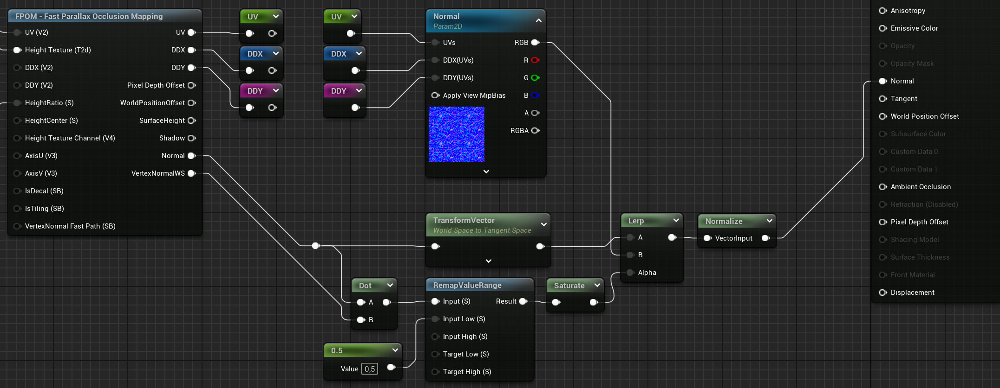

# Combined Normals

You can combine normals to use the derived normals where the projection is steep (side of things) and the normal texture for detail where the projection is flat (top of things).
This produces an overall better result than using either normal alone.

<a href="#" class="zoom-in" title="toggle zoom"><svg xmlns="http://www.w3.org/2000/svg" width="32" height="32" viewBox="0 0 32 32"><path d="M0 14.304q0-5.92 4.192-10.112t10.112-4.192 10.176 4.192 4.192 10.112q0 4.512-2.624 8.192l5.952 5.952-3.552 3.552-5.952-5.952q-3.68 2.624-8.192 2.624-5.92 0-10.112-4.192t-4.192-10.176zM4.064 14.304q0 4.256 3.008 7.264t7.232 2.976 7.264-2.976 3.008-7.264-3.008-7.2-7.264-2.976-7.232 2.976-3.008 7.2zM8.192 16.384v-4.064h4.128v-4.128h4.064v4.128h4.128v4.064h-4.128v4.128h-4.064v-4.128h-4.128z"></path></svg></a><a href="#" class="zoom-out" title="toggle zoom"><svg xmlns="http://www.w3.org/2000/svg" width="32" height="32" viewBox="0 0 32 32"><path d="M0 14.304q0-5.92 4.192-10.112t10.112-4.192 10.176 4.192 4.192 10.112q0 4.512-2.624 8.192l5.952 5.952-3.552 3.552-5.952-5.952q-3.68 2.624-8.192 2.624-5.92 0-10.112-4.192t-4.192-10.176zM4.064 14.304q0 4.256 3.008 7.264t7.232 2.976 7.264-2.976 3.008-7.264-3.008-7.2-7.264-2.976-7.232 2.976-3.008 7.2zM8.192 16.384v-4.064h12.32v4.064h-12.32z"></path></svg></a><a href="#" class="fullscreen" title="toggle fullscreen"><svg xmlns="http://www.w3.org/2000/svg" width="32" height="32" viewBox="0 0 32 32"><path d="M4.576 20.576H0V32h11.424v-4.576H4.576v-6.848zM0 11.424h4.576V4.576h6.848V0H0v11.424zm27.424 16h-6.848V32H32V20.576h-4.576v6.848zM20.576 0v4.576h6.848v6.848H32V0H20.576z"></path></svg></a><a href="#" class="fullscreen-exit" title="toggle fullscreen"><svg xmlns="http://www.w3.org/2000/svg" width="32" height="32" viewBox="0 0 32 32"><path d="M0 25.152h6.848V32h4.576V20.576H0v4.576zM6.848 6.848H0v4.576h11.424V0H6.848v6.848zM20.576 32h4.576v-6.848H32v-4.576H20.576V32zm4.576-25.152V0h-4.576v11.424H32V6.848h-6.848z"></path></svg></a>

<button></button>

FPOM

FPOM + Combined Normals

> [!INFO] Detailed Normals
> Combining normals is only for when you have two normals describing "the same thing". 
> Use BlendAngleCorrectedNormals if you have detailed normals as you would with a standard Normal texture sample.

## Setup

1. Do a dot product to get a mask telling us if the current pixel is flat or at an angle.
2. We remap the value to make it a bit more aggressive
3. (Skip if Decal) Transform the normal before lerping if the material uses tangent space normals.
4. Normalize the output before plugging it into the material Normal output.

> [!WARNING] Tangent Space (Surface materials)
> The Normal output is in World Space. So remember to use a Transform node to convert it to Tanget Space if your surface material uses Tangent Normals.