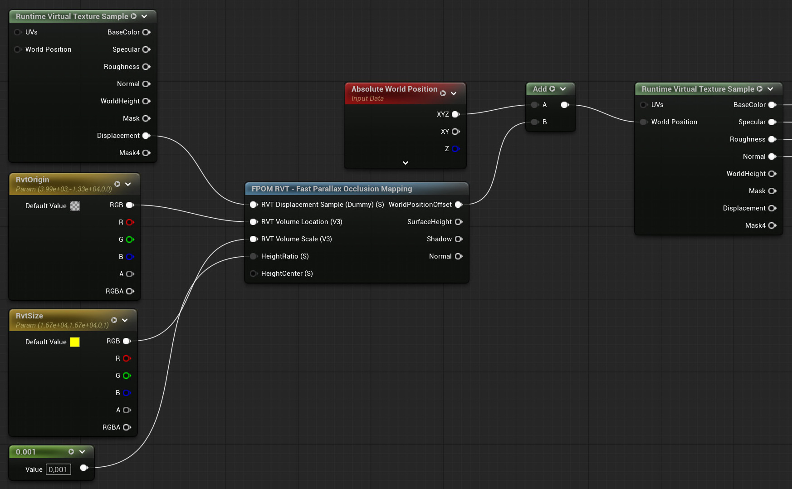

# FPOM with RVT landscapes using RVT Displacement

FPOM RVT node allows you to achieve POM using a single RVT Displacement texture sample. This is useful for landscapes since you can write all the layers to a single virtual texture, and then at render time only read that one texture.

> [!WARNING] RVT Displacement - UE 5.4+
> RVT Displacement feature was first added in 5.4, and is required for FPOM RVT to work.

## Setup

1. Create a new `Runtime Virtual Texture` and set it to use `Displacement`
2. Add a new `Runtime Virtual Texture Volume` to your landscape and assign the RVT_Displacement asset
3. Add the RVT_Displacement to your landscape list `Draw in Virtual Textures`

### Landscape Material - Output

1. Pipe the material Displacement and hook it up to the `Runtime Virtual Texture Output` Displacement channel

### Landscape Material - Sample

1. Add a `Runtime Virtual Texture Sample` node, set it to use RVT_Displacement asset and set `Virtual Texture Content` to Displacement
2. Add a `Constant3Vector` node and add the Location of the `Runtime Virtual Texture Volume` to it
3. Add a `Constant3Vector` node and add the Scale of the `Runtime Virtual Texture Volume` to it
4. Add a `Constant` node and set it to `0.001` for now
5. Add a `FPOM RVT` node and connect the four nodes as shown in the image bellow
6. Add a `Absolute World Position` node and do a `Add` with it and FPOMs `WorldPositionOffset` output
7. Hook the output of this into the `Runtime Virtual Texture Sample` (BaseColor, etc) World Position input

> [!WARNING] Virtual Textures
> RVT loads parts in a tiled page layout. Everything is not loaded the whole time like a normal Height Texture is.
> This can cause some loading popping when the RVT pages are loading. And is a side effect with RVT that can't be avoided.